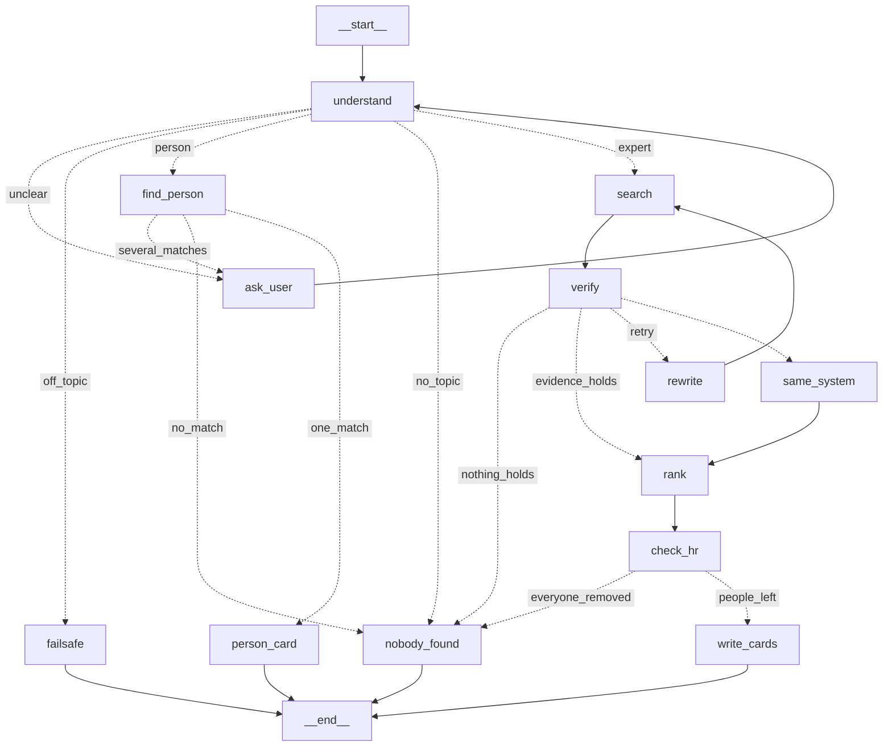

# Who To Ask

An internal "who should I ask?" assistant. You describe what you need help with, and an agent searches fake Jira, Confluence, Teams, and HR data to find the right colleagues. It says why each person can help, and it writes a ready-to-send message for each one. It also answers simple work questions about a colleague: their job title, team, manager, or contact details.

It is a portfolio prototype that I built to learn LangGraph. **All the data is fake:** the company, Tamberly Insurance, does not exist, and its email addresses end in `.example`, so no message can reach a real person.

**Demo video:** https://youtu.be/lIEKEShEyoE

## What it does

- **Find an expert.** "Who can help me with X?", "Who fixed X?", "Who decided X?". The answer is up to 3 people, best first. Each one has a card: why this person can help, the tickets and pages behind it, a suggested message, and two buttons.
- **Ask about a colleague.** "Who is Sophie Martin's manager?", then "What does she work on?". Work information only: a personal question gets a polite refusal.
- **It asks instead of guessing.** "The API" fits two systems, and two people are called Sophie: the agent asks which one, with choices that come from the data.
- **It never invents anyone.** When nothing holds up, it says "nobody found". And it never recommends someone who left the company, or who opted out of being found: plain code checks this, not the LLM.
- **It never sends anything.** The two buttons only open my own Teams or email app, with the message filled in.
- **English or French:** the answer is in the language of the question.

One real answer, in the terminal. The two other cards and the links are left out here:

```text
Question: Who can help me get access to the Claims API?

Steps:
   Read your question: you are looking for someone who can help
   Searched pages and tickets for "Claims API", "get access": 13 results
   Checked 13 results: 8 are really about your question
   Found 5 people behind these pages and tickets
   Removed: 1 person who left the company, 1 person who opted out
   Wrote the cards of 3 people

Étienne Lavoie wrote "Claims API - how to get an API key", but no longer works at the company. 1
person opted out of being found.

1. Sophie Martin, Senior Developer, Claims Platform
   Email: sophie.martin@tamberly.example
   Out of office until 10 November 2026
   Why: Wrote the Claims API access guide and handled several access requests.
   Evidence: "Claims API: Access Guide" (Confluence), CLM-212, CLM-245, CLM-301 (Jira)

   Suggested message:
   "Hi Sophie, I'm [your name] from [your team]. I'm trying to get access to the Claims API. I saw
    you wrote the access guide and handled requests for it. Where should I start? I see you're away
    until 10 November, so no rush. Thank you!"
```

## How it works

The agent is one LangGraph graph. LangGraph drew this diagram from the compiled graph, so it matches the code. A dotted arrow is a choice: a small function reads the state and picks the road.



To draw it again from the code:

```powershell
python -c "from agents import AgentWorkflow; agent = AgentWorkflow(); print(agent.compiled_workflow.get_graph().draw_mermaid(with_styles=False)); agent.close()"
```

| Node | Who decides | What it does |
|---|---|---|
| `understand` | LLM | Reads the request and picks its road: find an expert, a question about a colleague, unclear, or not about work |
| `ask_user` | The user | Pauses the run and asks one question, with choices from the data. The answer goes back to `understand` |
| `search` | Code | Searches the tickets and the pages, with keywords and embeddings together |
| `verify` | LLM | Reads each ticket and page found, one at a time: is it really about the question? |
| `rewrite` | LLM | Nothing held up: writes other search words, for one retry |
| `same_system` | Code | Still nothing, and the question names a system: takes the people who work on that system. The answer says so |
| `rank` | Code | Finds the people behind the evidence, and orders them with simple rules |
| `check_hr` | Code | Removes the people who left or opted out, and keeps up to 3 |
| `write_cards` | LLM | Writes the "why" sentence and the middle of the suggested message. Plain code writes the rest of the card from the data |
| `find_person`, `person_card` | Code | Look a colleague up in the directory, and decide what the answer may show |
| `nobody_found`, `failsafe` | Code | Fixed texts: nobody was found, "What do you need help with?" for a request with no topic, or a polite refusal |

- **The LLM decides three things:** what the request is, when to ask me, and whether a ticket or a page is really about the question. It also writes the search words of the retry and the short texts of a card. Everything else is plain code: cheap, predictable, and easy to explain.
- **The LLM works with ids.** Names, emails, links, and evidence come from the data, never from the LLM.
- **The ranking fits in one sentence:** the type of question decides which source counts first. "Who can help?": Confluence, then Jira. "Who fixed it?": Jira, then Confluence. "Who decided?": only the owner of a recorded decision.
- **Speed and cost:** a usual expert answer takes 5 to 7 seconds and costs about a fifth of a cent.

### What it is built with

| Part | What I used |
|---|---|
| The agent | LangGraph: one graph with a shared state, routers, a retry loop with a counter, a pause that asks the user (`interrupt()`), and steps that are streamed while it works |
| The LLM | OpenAI `gpt-6-luna` through LangChain, with structured output: one Pydantic model per decision. `text-embedding-3-small` for the search |
| The search | Keywords (BM25) and embeddings together, merged with Reciprocal Rank Fusion |
| The company data | MongoDB, filled from the files in `data/` |
| The memory | LangGraph's Postgres checkpointer, with one `thread_id` per conversation. It is how "And who's her manager?" knows who "her" is, and where a paused run waits for my answer |
| The API | FastAPI |
| The page | React and TypeScript, built with Vite |
| For AI assistants | An MCP server with two tools |
| Tracing | LangSmith (optional) |

## The folders

The main files and folders:

```text
app.py                    # the agent in the terminal
agents/                   # the graph (workflow.py) and the classes it uses
sources/                  # the classes that read the company data
config/                   # the settings, the constants, and the fixed texts
data/                     # the fake company, as JSON and Markdown files
scripts/                  # the seed, the two checks, and the scenario report
checks/                   # the classes behind the data check
api/                      # the API
frontend/                 # the page
mcp_server/               # the MCP server
tests/                    # the free tests and the paid tests
utils/                    # the logger
design/                   # my drawing of the page
honest_questions.md       # my 20 questions and their scoring guide
honest_run/               # the first run of the 20 questions: every answer, with its scoring
honest_run_after_fix/     # the same, for the run after the first fix
honest_run_after_fixes/   # the same, for the run after the two fixes
check_questions_run/      # my 11 more questions, five tries each
```

## Run it

I built and ran it on Windows 11, so the commands are for PowerShell. It is not tried on another system.

You need Python 3.11, MongoDB running on this computer, and an OpenAI API key. Three more things are optional: Node.js for the page, PostgreSQL for a memory that survives a restart, and a LangSmith key for tracing. (I used MongoDB 9.0, Node.js 24, and PostgreSQL 18.)

From the project folder:

```powershell
python -m venv venv
.\venv\Scripts\Activate.ps1        # if PowerShell refuses: Set-ExecutionPolicy -Scope CurrentUser RemoteSigned
pip install -r requirements.txt
Copy-Item .env.example .env        # then open .env and paste your OpenAI key after OPENAI_API_KEY=
python -m scripts.check_settings   # ends with "Settings OK". It shows the names of the settings, never their values
python -m scripts.seed_mongodb     # copies data/ into MongoDB. Once, and again after a change in data/
python -m scripts.check_data       # ends with "Data OK, and every scenario exists in the data"
```

- **MongoDB somewhere else:** put its address in `MONGODB_URI`, in `.env`. A cloud cluster should work the same way: not tried.
- **Postgres (optional):** create a database called `who_to_ask`. Then, in `.env`, remove the `#` in front of the `POSTGRES_URI` line and put your password in it. Without Postgres, the app runs the same way, and it forgets its conversations when it stops.
- **LangSmith (optional):** put a key after `LANGSMITH_API_KEY=`, and every run is traced in the project `who-to-ask`.

The same agent has four doors:

| Door | Start it | Then |
|---|---|---|
| Terminal | `python app.py "Who can help me get access to the Claims API?"` | `python app.py` alone holds a conversation: follow-ups, and the number of a choice when the agent asks |
| API | `python -m uvicorn api.main:app` | Open `http://127.0.0.1:8000/docs` to try it (this page needs the internet in the browser) |
| Page | `npm install` once in `frontend/`, then `npm run dev` | Open `http://localhost:5173`, while the API runs in another terminal |
| MCP server | The app of an AI assistant starts it itself | See below |

- **The API** has two endpoints. `POST /ask` takes `{"question": "..."}` and returns the answer as JSON: a `status` (`answered`, `person`, `needs_details`, `nobody_found`, or `off_topic`), the cards, the note, and the step lines. `POST /ask/stream` sends each step line while the agent works, then the same answer.
  - Every answer has a `thread_id`. Send it back with a follow-up, and the agent knows who "her" is.
  - When the agent asks a question (`needs_details`), answer with the `id` of a choice as `question`, the same `thread_id`, and `"is_answer": true`.
  - `user_name` and `user_team` are optional. They fill the first sentence of the suggested messages, and they go nowhere else: not to the LLM, not to the memory, and not to the log.
- **The page** uses six packages, and no more: React (two packages), TypeScript, the build tool Vite, and TypeScript's two descriptions of React.
- **The MCP server.** MCP is a standard way to plug tools into an AI assistant. The app of the assistant starts the server itself and talks to it through the program's input and output, so nothing listens on a port. An app needs three things to connect: the command (the Python of the venv), its two arguments (`-m mcp_server.server`), and `PYTHONPATH` set to the project folder. For example, with Claude Code:

  ```powershell
  claude mcp add --env "PYTHONPATH=C:\path\to\who-to-ask" --transport stdio who-to-ask -- "C:\path\to\who-to-ask\venv\Scripts\python.exe" -m mcp_server.server
  ```

  The server has two tools: `ask(question, thread_id)` for a question or a follow-up, and `pick_choice(thread_id, choice_id)` to answer a question of the agent. A tool gives the answer back as one short text, built in code: what the terminal shows, without the links and the step lines. I tried it with Claude Code. Cursor, Claude Desktop, and the MCP Inspector are not tried.

## How it was tested

| Kind of test | What it checks |
|---|---|
| 597 free tests: `python -m pytest` | The plain code, with no OpenAI call: the ranking, the HR check, the links, the roads of the graph with a fake LLM, the API, the MCP server, and the data |
| 106 paid tests: `python -m pytest -m openai` | The real model, for a few cents: the 15 demo scenarios, from the question to the answer. They check names, not wording |
| A data check: `python -m scripts.check_data` | Every id points to a real record, and every demo scenario exists in the data |
| Twenty tries | The model does not always decide the same way, so a borderline case is asked 20 times before a prompt is kept |
| A test of the tests | For the two fixes below, 29 lines of new code were broken on purpose, one at a time. The free tests noticed 28, and the last one led to a corrected test |
| 70 API tests in Postman | I run them with Postman's collection runner, and all of them pass |

The first three need MongoDB running and seeded. Without Postgres, 10 of the free tests are skipped: the ones of the memory in Postgres.

### The honest test

The demo scenarios were written together with the data, so they can look rigged. So on 2026-11-20 I wrote 20 questions of my own from a one-page summary of the company (`data/company_summary.md`), with a scoring guide. I kept them closed for Claude Code, the AI assistant that wrote the data and most of the code, until the day of the test. The official test is one run, on the code and the data as they were, scored strictly: in doubt, the lower score.

- **The first run, the official score: 14 of 20.** Nobody wrong was recommended, nobody who left or opted out appeared, and what had to be refused was refused. Four of the six misses were one kind of question, "X is broken, who do I talk to?": no ticket describes a new problem, so the answer was "nobody found", although people work on that system. The two others were strict calls of my guide.
- **After two fixes: 19 of 20,** which can move by one from run to run (see the second limit). The fixes: when nothing is about the exact problem and the question names a system, the agent now shows the people who work on that system, under a clear label. And a question with no topic ("I need help. Who should I ask?") is no longer searched: the agent asks what I need.
- **What Git can't prove.** This repository was published with a fresh history, so Git no longer shows the order of events: it can't prove that I wrote my questions before the data. The log files and the commit ids that the scoring files and the `run_info.json` files name are not in this repository.
- **The record:** the questions and the guide (`honest_questions.md`), every answer of the first run with its scoring (`honest_run/`), and the three runs side by side (`honest_run_after_fixes/scoring.md`).

### The limits

- **The second level needs the name of the system, written right.** With a spelling mistake ("Policy Admn") or a description in place of the name, the answer can still be "nobody found". I checked the fix with 11 more questions of my own, five tries each: 45 of 55 answers pass (`check_questions_run/`). I prefer "nobody found" to a wrong name: in 135 tries on nine trap questions, about things that are none of the 16 systems, no system was named.
- **`verify` does not always give the same verdict on the same ticket,** so an answer that depends on one borderline ticket can change from one run to the next.
- **A request with one empty word can still get people.** "Something is broken. Who should I call?" got three people in 3 tries of 3: a wrong answer.
- **It is a prototype.** No login and no limit on the number of questions: the API only listens on the computer that runs it. Old conversations are never deleted, whoever has the id of a conversation can continue it, and the memory keeps the text of the questions.
- **Smaller ones.** The agent asks one question per request, and it only spots a vague system name. A follow-up knows the people of the earlier answers, not their topic. The page forgets the conversation when it is reloaded, except my name and my team. Through MCP, what an assistant says with the text of a tool is the assistant's own.

## Next steps

- **Ask `verify` three times** for each ticket or page, and keep the majority. It triples the calls of the most expensive step, so it has to be measured first.
- **Help the second level with names:** give `understand` the one-line description of each system, give each system a French name in the data, and say that a misspelled name is still a name. It makes a wrong name more likely, so the trap questions have to be measured again.
- **Close the gap of the empty words:** a short list in plain code ("problem", "issue", "broken"), or a "no topic" road in `understand`.
- **Follow the links between tickets,** so that a ticket that only says "follows X" is not missed when it is read alone.
- **The other direction of MCP:** the agent itself uses MCP tools, for example a real Jira or Confluence server, through LangChain's MCP adapters.
- **Wait for replies, and rank again from them.** Today the app never sends anything, on purpose.
- **For real use:** real connectors in place of the fake data, a login, and a rule that deletes old conversations.

## More to read

- `data/scenario_evidence.md`: for each demo scenario, who has which evidence, and why they rank where they do.
- `design/page_mockup.html`: my drawing of the page.
