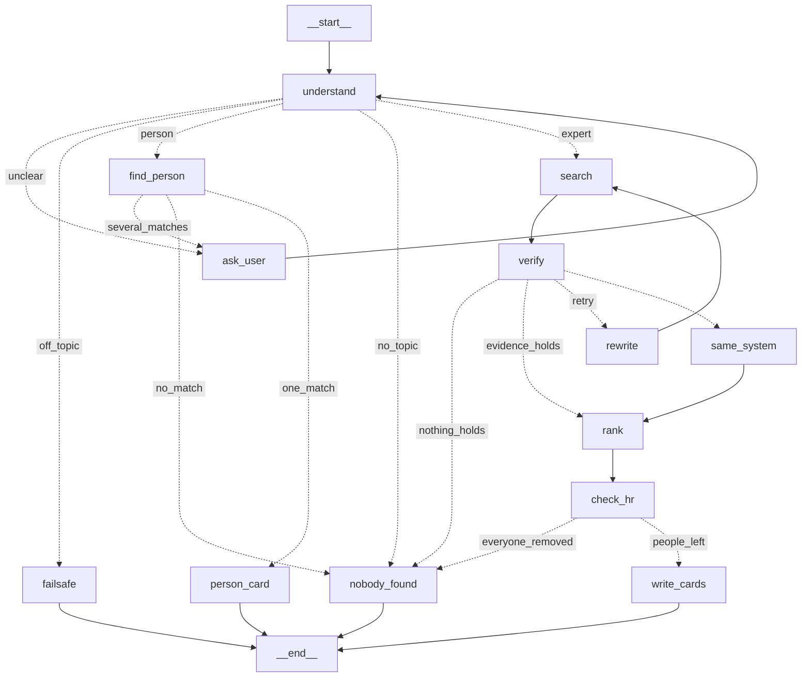

# Who To Ask


An internal "who should I ask?" assistant. You describe what you need help with, in English or in French, and an agent searches fake Jira, Confluence, Teams, and HR data to find the right colleagues. It is a portfolio prototype that I built to learn LangGraph. **All the data is fake.**

[](https://youtu.be/lIEKEShEyoE)

---

## 🔍 What it does

- **Find an expert:** up to 3 people, best first, each with the evidence and a suggested message.
- **Ask about a colleague:** job title, team, manager, or contact details. Work information only.
- **It asks instead of guessing:** "the API" fits two systems, so it asks which one.
- **It never invents anyone:** it says "nobody found", and plain code removes anyone who left or opted out.
- **It never sends anything:** a card's two buttons only open my own Teams or email app.

---

## 🧭 How it works

LangGraph drew this diagram from the compiled graph, so it matches the code.



- **The LLM decides three things:** what the request is, when to ask me, and whether a ticket or a page is really about the question.
- **Everything else is plain code:** cheap, predictable, and easy to explain.
- **Names, emails, links, and evidence come from the data,** never from the LLM.

---

## 🧰 Tech stack

- **Agent:** LangGraph, LangChain, and OpenAI with structured output
- **Backend and data:** Python, FastAPI, MongoDB, and Postgres
- **Frontend:** React, TypeScript, and Vite
- **Testing and tools:** pytest, Postman, LangSmith, and an MCP server

---

## 🧪 Tests

70 API tests in Postman, all passing. The other tests and my honest test are in [the details](docs/details.md#how-it-was-tested).

---

## 🚧 Main limits

- **A question about a new problem must name its system, written right.** With a spelling mistake, the answer can still be "nobody found".
- **On a borderline ticket, `verify` does not always give the same verdict,** so the answer can change from one run to the next.
- **A request with one empty word can still get people.** "Something is broken. Who should I call?" got three people: a wrong answer.

---

## 🚀 Quick start

You need Python, MongoDB running on this computer, and an OpenAI API key. Node.js is for the page. The commands are for PowerShell.

```powershell
python -m venv venv
.\venv\Scripts\Activate.ps1
pip install -r backend\requirements.txt
Copy-Item .env.example .env        # then paste your OpenAI key in .env
cd backend
python -m scripts.seed_mongodb     # copies the fake data into MongoDB
python -m uvicorn api.main:app     # the API
```

Then the page, in a second terminal:

```powershell
cd frontend
npm install
npm run dev                        # then open http://localhost:5173
```

---

## 📚 More to read

[docs/details.md](docs/details.md): one real answer, what each node does, every test, every limit, and the next steps.
