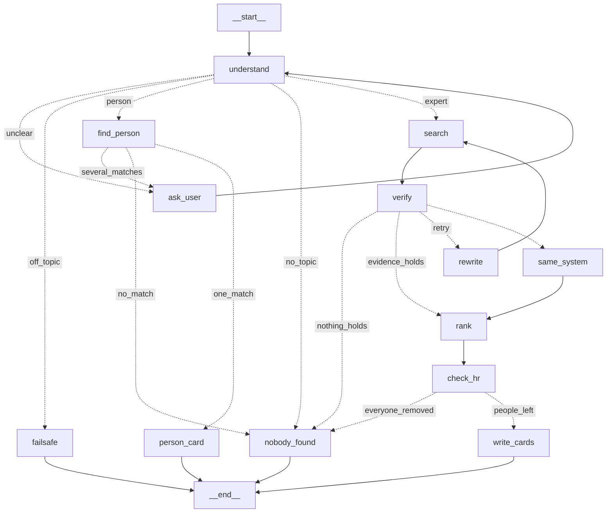

# Who To Ask

An internal "who should I ask?" assistant. You describe what you need help with, and an agent searches fake Jira, Confluence, Teams, and HR data to find the right colleagues. It says why each person can help, and it writes a ready-to-send message for each one. It also answers simple work questions about a colleague: their job title, team, manager, or contact details.

It is a portfolio prototype that I built to learn LangGraph. **All the data is fake:** the company, Tamberly Insurance, does not exist, and its email addresses end in `.example`, so no message can reach a real person.

**Demo video:** https://youtu.be/lIEKEShEyoE

## What it does

- **Find an expert.** "Who can help me with X?", "Who fixed X?", "Who decided X?". The answer is up to 3 people, best first. Each one has a card: why this person can help, the tickets and pages behind it, a suggested message, and two buttons.
- **Ask about a colleague.** "Who is Sophie Martin's manager?", then "What does she work on?". Work information only: a personal question gets a polite refusal.
- **It asks instead of guessing.** "The API" fits two systems, and two people are called Sophie: the agent asks which one, with choices that come from the data.
- **It never invents anyone.** When nothing holds up, it says "nobody found". And it never recommends someone who left the company, or who opted out of being found: plain code checks this, not the LLM.
- **It never sends anything.** The two buttons only open my own Teams or email app, with the message filled in.
- **English or French:** the answer is in the language of the question.

One real answer, in the terminal, is in [the details](docs/details.md#one-real-answer).

## How it works

The agent is one LangGraph graph. LangGraph drew this diagram from the compiled graph, so it matches the code. A dotted arrow is a choice: a small function reads the state and picks the road.



- **The LLM decides three things:** what the request is, when to ask me, and whether a ticket or a page is really about the question. It also writes the search words of the retry and the short texts of a card. Everything else is plain code: cheap, predictable, and easy to explain.
- **The LLM works with ids.** Names, emails, links, and evidence come from the data, never from the LLM.
- **The ranking fits in one sentence:** the type of question decides which source counts first. "Who can help?": Confluence, then Jira. "Who fixed it?": Jira, then Confluence. "Who decided?": only the owner of a recorded decision.
- **Speed and cost:** a usual expert answer takes 5 to 7 seconds and costs about a fifth of a cent.

What each node does, and the command that draws the diagram again, are in [the details](docs/details.md#the-nodes).

### What it is built with

| Part | What I used |
|---|---|
| The agent | LangGraph: one graph with a shared state, routers, a retry loop with a counter, a pause that asks the user (`interrupt()`), and steps that are streamed while it works |
| The LLM | OpenAI `gpt-6-luna` through LangChain, with structured output: one Pydantic model per decision. `text-embedding-3-small` for the search |
| The search | Keywords (BM25) and embeddings together, merged with Reciprocal Rank Fusion |
| The company data | MongoDB, filled from the files in `data/` |
| The memory | LangGraph's Postgres checkpointer, with one `thread_id` per conversation. It is how "And who's her manager?" knows who "her" is, and where a paused run waits for my answer |
| The API | FastAPI |
| The page | React and TypeScript, built with Vite |
| For AI assistants | An MCP server with two tools |
| Tracing | LangSmith (optional) |

## Run it

I built and ran it on Windows 11, so the commands are for PowerShell. It is not tried on another system.

You need Python 3.11, MongoDB running on this computer, and an OpenAI API key. Three more things are optional: Node.js for the page, PostgreSQL for a memory that survives a restart, and a LangSmith key for tracing. (I used MongoDB 9.0, Node.js 24, and PostgreSQL 18.)

From the project folder:

```powershell
python -m venv venv
.\venv\Scripts\Activate.ps1        # if PowerShell refuses: Set-ExecutionPolicy -Scope CurrentUser RemoteSigned
pip install -r requirements.txt
Copy-Item .env.example .env        # then open .env and paste your OpenAI key after OPENAI_API_KEY=
python -m scripts.check_settings   # ends with "Settings OK". It shows the names of the settings, never their values
python -m scripts.seed_mongodb     # copies data/ into MongoDB. Once, and again after a change in data/
python -m scripts.check_data       # ends with "Data OK, and every scenario exists in the data"
```

The same agent has four doors:

| Door | Start it | Then |
|---|---|---|
| Terminal | `python app.py "Who can help me get access to the Claims API?"` | `python app.py` alone holds a conversation: follow-ups, and the number of a choice when the agent asks |
| API | `python -m uvicorn api.main:app` | Open `http://127.0.0.1:8000/docs` to try it (this page needs the internet in the browser) |
| Page | `npm install` once in `frontend/`, then `npm run dev` | Open `http://localhost:5173`, while the API runs in another terminal |
| MCP server | The app of an AI assistant starts it itself | See [the details](docs/details.md#the-api-the-page-and-the-mcp-server) |

The other settings (MongoDB somewhere else, Postgres, LangSmith), the two endpoints of the API, the page, and how an AI assistant connects to the MCP server are in [the details](docs/details.md#run-it-the-details).

## How it was tested

| Kind of test | What it checks |
|---|---|
| 597 free tests: `python -m pytest` | The plain code, with no OpenAI call: the ranking, the HR check, the links, the roads of the graph with a fake LLM, the API, the MCP server, and the data |
| 106 paid tests: `python -m pytest -m openai` | The real model, for a few cents: the 15 demo scenarios, from the question to the answer. They check names, not wording |
| A data check: `python -m scripts.check_data` | Every id points to a real record, and every demo scenario exists in the data |
| Twenty tries | The model does not always decide the same way, so a borderline case is asked 20 times before a prompt is kept |
| A test of the tests | For the two fixes below, 29 lines of new code were broken on purpose, one at a time. The free tests noticed 28, and the last one led to a corrected test |
| 70 API tests in Postman | I run them with Postman's collection runner, and all of them pass |

The first three need MongoDB running and seeded. Without Postgres, 10 of the free tests are skipped: the ones of the memory in Postgres.

### The honest test

The demo scenarios were written together with the data, so they can look rigged. So on 2026-11-20 I wrote 20 questions of my own from a one-page summary of the company (`data/company_summary.md`), with a scoring guide. I kept them closed for Claude Code, the AI assistant that wrote the data and most of the code, until the day of the test.

- **The first run, the official score: 14 of 20.** Nobody wrong was recommended, nobody who left or opted out appeared, and what had to be refused was refused. Four of the six misses were one kind of question, "X is broken, who do I talk to?": no ticket describes a new problem, so the answer was "nobody found", although people work on that system.
- **After two fixes: 19 of 20,** which can move by one from run to run (see the second limit). The fixes: when nothing is about the exact problem and the question names a system, the agent now shows the people who work on that system, under a clear label. And a question with no topic ("I need help. Who should I ask?") is no longer searched: the agent asks what I need.

The two other misses, what Git can't prove about this test, and the record of the runs are in [the details](docs/details.md#the-honest-test).

### The main limits

- **The first fix needs the name of the system, written right.** With a spelling mistake ("Policy Admn") or a description in place of the name, the answer can still be "nobody found". I checked the fix with 11 more questions of my own, five tries each: 45 of 55 answers pass (`evaluation/check_questions_run/`).
- **`verify` does not always give the same verdict on the same ticket,** so an answer that depends on one borderline ticket can change from one run to the next.
- **A request with one empty word can still get people.** "Something is broken. Who should I call?" got three people in 3 tries of 3: a wrong answer.
- **It is a prototype.** No login and no limit on the number of questions: the API only listens on the computer that runs it.

All the limits, with their numbers, are in [the details](docs/details.md#the-limits).

## More to read

- [docs/details.md](docs/details.md): one real answer, what each node does, the details of "Run it", the full honest test, all the limits, and the next steps.
